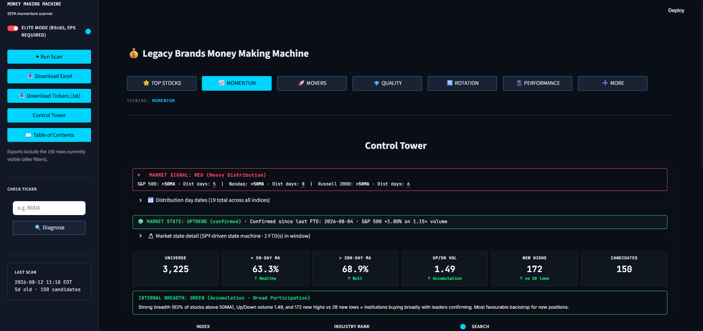
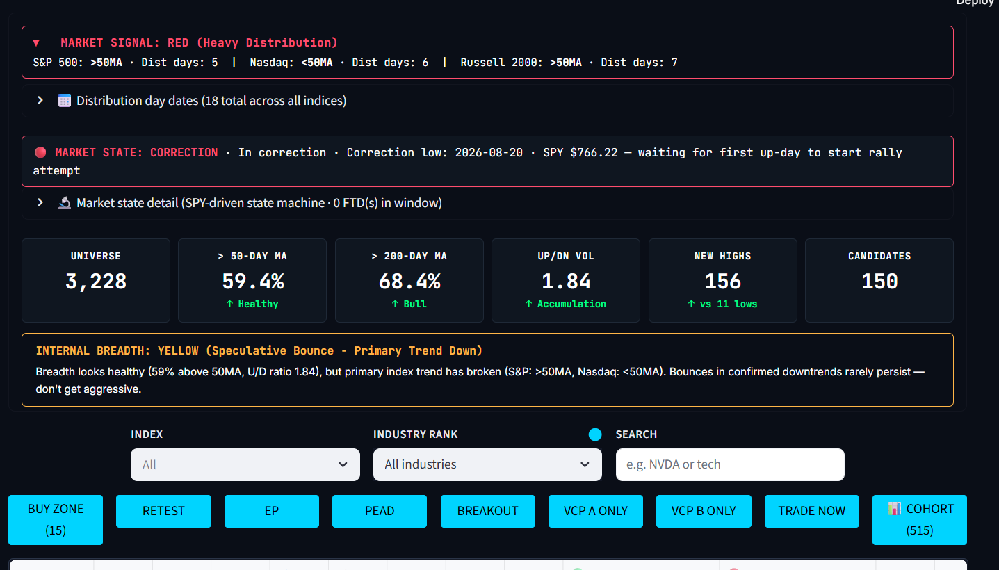
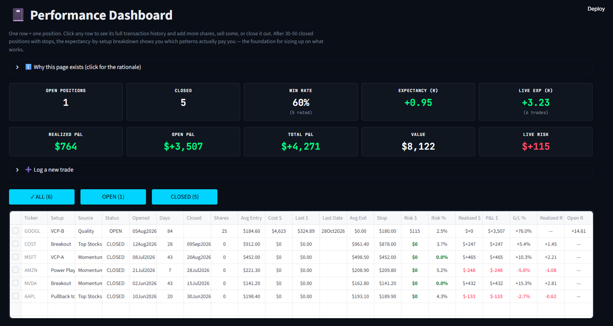

# Legacy Brands Money Making Machine

A Minervini/O'Neil momentum scanner and trade journal, Python/Streamlit. Runs locally against the full US equity universe (~3,225 tickers), implements SEPA and CAN SLIM filtering rules, and includes a built-in position journal with full R-multiple accounting, a market state machine, industry rotation analysis, and seven distinct scan modes.



---

## How this was built

I'm not a professional developer. I designed the system, wrote the specification, and directed Claude (Anthropic's coding model) to implement, test, and ship it iteratively over roughly six months — moving from a working Google Colab notebook through a Streamlit v1, then through hundreds of review-and-revise iterations across 14 pushed releases.

The original specification I wrote and worked from is preserved in [`docs/original_colab_spec_v8.docx`](docs/original_colab_spec_v8.docx). Every subsequent change was reviewed, tested in the running app, and either accepted or sent back for revision — AI-assisted construction with human spec, judgment, and acceptance testing throughout.

---

## What it does

The app runs after the market close, pulls daily OHLCV data for the US equity universe, applies the Minervini trend template (price > 50MA > 150MA > 200MA, 200MA rising, relative strength ≥ 85 in Elite mode), and surfaces candidates passing additional entry-signal detectors:

- **BUY ZONE** — anticipatory composite (accumulation pressure + near-50MA + VCP pattern + $20M ADV liquidity floor)
- **RETEST** — pullback to a prior breakout pivot on quiet volume
- **EP** — Qullamaggie-style Episodic Pivot (8% gap on 3× volume from neglected base)
- **PEAD** — Post-Earnings Announcement Drift
- **BREAKOUT** — confirmed pivot-cross with volume
- **VCP A / B** — graded Volatility Contraction Patterns
- **POWER PLAY**, **CHEAT**, **GAP UP**, **RS✓** — supporting signals

Alongside the main Momentum scan, the app includes a reverse-funnel **MOVERS** scan (demand-first instead of structure-first), an IBD-style **QUALITY** fundamentals scan, industry **ROTATION** analysis, a **TOP STOCKS** intersection view, and a complete **PERFORMANCE** journal.

---

## Control Tower and signals



Every scan session opens with the **Control Tower** — a market context layer showing the Minervini distribution-day signal (GREEN/YELLOW/RED), the O'Neil state machine (UPTREND / RALLY_ATTEMPT / CORRECTION) with Follow-Through-Day detection, breadth tiles, and composite internal breadth. The signal filter buttons below (BUY ZONE, RETEST, EP, PEAD, BREAKOUT, VCP A, VCP B, TRADE NOW, COHORT) let you narrow the candidate list by setup type.

The state machine implements O'Neil-style methodology with two downgrade paths: fast-kill (≥2 fresh distribution days post-FTD) and slow-grind (≥5 distribution days in trailing 25 sessions, with a 10-session grace period post-FTD). Correction-low tracking supports proper RALLY_ATTEMPT → UPTREND progression on the next qualifying FTD.

---

## Trade journal with R-multiple accounting



The **PERFORMANCE** tab is a full position-tracking journal, not just a trade log. It supports:

- Multi-tranche positions with adds and partial exits
- Immutable initial-stop anchor (R-multiples stay honest even after stop moves)
- Live risk calculation (current stop) vs. historical R calculation (initial stop)
- Days held, cost basis, realized vs. unrealized P&L, G/L%, and Open R per position
- Dashboard tiles for Total P&L, Open P&L, Portfolio Value, Live Risk, and Total R
- Per-trade Decision Snapshot panel that captures the setup context at the time of entry

Open R on a held position tells you how far into the trade you are relative to your original risk. Realized R on a closed trade tells you what you actually extracted. Both numbers survive stop moves cleanly.

A loadable demo dataset lives at [`docs/journal.sample.json`](docs/journal.sample.json) — six made-up trades on well-known tickers, labeled SAMPLE DATA in the notes. Copy it into `data/journal.json` to populate the Performance tab with example positions without needing your own trading history.

---

## Technical overview

| Layer | Implementation |
|---|---|
| Front-end | Streamlit with custom dark-theme CSS (Bloomberg-vibe) |
| Charts | Plotly (candlesticks, VCP contraction zones, Fibonacci overlays) |
| Data | yfinance (primary) + Stooq (secondary fallback) |
| Persistence | JSON for scan archives, pickle for per-ticker price cache, atomic writes with rate-limit guardrail |
| Fundamentals | yfinance quarterly income statements with TTL cache |
| State | SPY-driven FTD state machine with trailing-25 distribution counter |
| Universe | NASDAQ Trader + S&P 500 + Nasdaq-100 + iShares IWM/IWV, with fallback to the last healthy scan's ticker list |

Architecture favors module boundaries over inheritance — scanner logic (`scanner/*.py`) is pure-function where possible, UI (`ui/*.py`) is dumb render, data layer (`scanner/data_cache.py`, `scanner/cache.py`) handles persistence. 26,000 lines across ~40 files, all under version control.

---

## Repository layout

```
Stock Scanner/
├── app.py                      Streamlit entry point + mode router
├── run.bat                     Windows launcher
├── requirements.txt
├── diagnose_data.py            Standalone Yahoo/Stooq connectivity test
├── scanner/
│   ├── core.py                 Scan pipeline, universe collection, RS calc, run_scan
│   ├── setups.py               VCP, breakout, buy zone, EP, PEAD, retest detectors
│   ├── cache.py                Scan save/load with rate-limit guardrail
│   ├── data_cache.py           Per-ticker price + fundamentals cache
│   ├── movers.py               Reverse-funnel demand scanner
│   ├── quality.py              IBD-style fundamentals scan
│   ├── rotation.py             Industry group rotation
│   ├── mean_reversion.py       Oversold-bounce scanner
│   ├── journal.py              Trade journal data layer
│   ├── buy_zone_cohort.py      Persistent BUY ZONE cohort log
│   ├── breakout_log.py         Persistent breakout log (powers RETEST)
│   ├── top_stocks.py           Momentum ∩ Quality intersection
│   ├── stooq.py                Secondary data source
│   └── ...
├── ui/
│   ├── style.py                Global CSS theme
│   ├── toc.py                  Table-of-contents dialogs
│   ├── deepdive_view.py        Per-ticker deep-dive
│   ├── journal_view.py         Performance tab
│   ├── movers_view.py
│   ├── quality_view.py
│   ├── top_stocks_view.py
│   ├── mean_reversion_view.py
│   └── cohort_view.py
├── tools/                      Debug/inspection scripts
├── docs/
│   ├── original_colab_spec_v8.docx   Original written specification
│   ├── CHANGES_SINCE_LAST_PUSH*.md   Historical release notes
│   ├── journal.sample.json           Demo trades for the Performance tab
│   └── screenshots/
└── data/                       Local scan + cache storage (gitignored)
```

---

## Setup and run

Full first-time setup and daily-use instructions are in **[GETTING_STARTED.md](GETTING_STARTED.md)**. The short version:

```
python -m venv .venv
.venv\Scripts\activate
pip install -r requirements.txt
run.bat
```

Dashboard opens at `http://localhost:8501`. First scan takes 30–60 minutes (cold cache); subsequent scans are 10–20 minutes.

---

## Known limitations

- **yfinance is not an SLA'd data source.** It's an undocumented scraper that works until it doesn't. Reliability is the biggest architectural weakness. See `diagnose_data.py` for a one-command check of whether Yahoo/Stooq are reachable from your IP.
- **End-of-day data only.** No intraday feed, no live quotes.
- **Signal thresholds are heuristics**, not backtested at scale. Treat them as filters, not guarantees.
- **No slippage/spread modeling.** Suggested buy triggers assume you can fill at the pivot.
- **No autonomous execution.** The Journal tracks what the user did; it doesn't place orders.

---

## License

© 2026 Elliott Walter. All rights reserved. Shared for review; not licensed for reuse.
